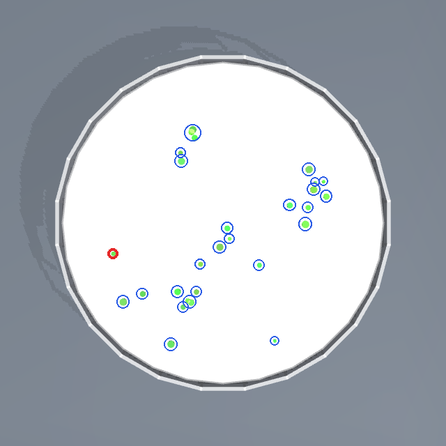
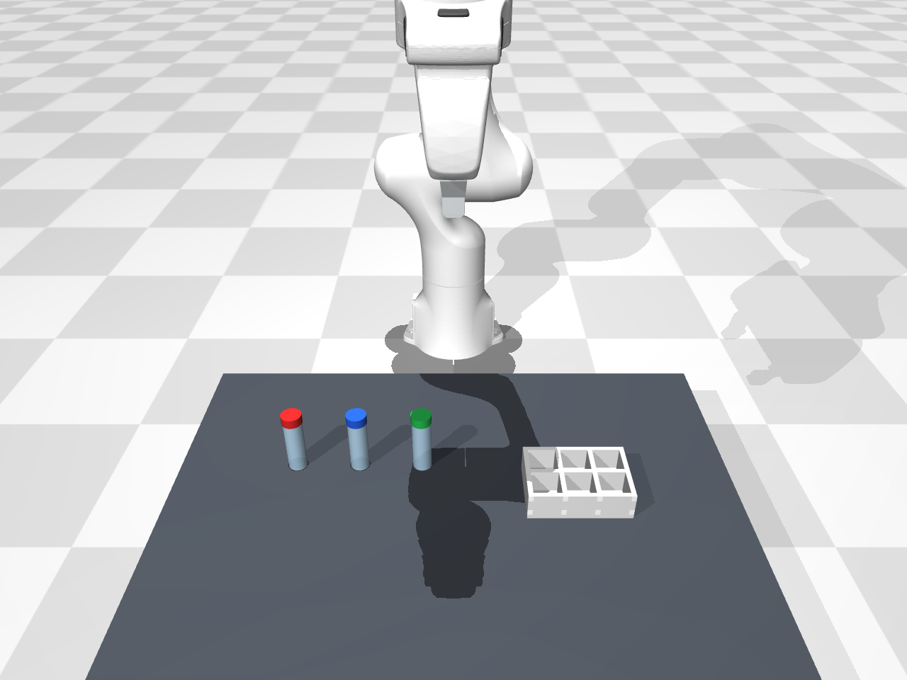

# MuJoCo Lab Sim

Simulated lab automation with a Franka Panda arm in MuJoCo, part of a sim-to-real / real-to-sim project inspired by Gemini 4 Hydrogen for robotics.

1. **Cyanobacteria colony picking and quadrant restreaking** (main project): a workflow a cyano researcher wants automated. Today's colony pickers (like the QPix) are built for E. coli and no robot streaks from plate to plate.
2. **Vial rack pick-and-place**: the warm-up demo.

## 1. Cyano colony pick and restreak


| Colony finder (red = chosen, most isolated) | Streak on the fresh plate (numbers = quadrant start, light to dark = stroke order, red would mean lifted off) |
|---|---|
|  |  |

### What the robot does

1. Lifts the lids off both plates and parks them on the bench.
2. Photographs the source plate from above and finds every colony (green dot).
3. Chooses the colony with the most empty space around it, so it picks a single clean colony.
4. Takes the next tool from a **24-slot rack** (like a pipette tip box): a **plastic loop** or a **wooden toothpick** (you choose). It opens the fingers only 3 mm wider than the handle and lifts the tool straight up by its full length, so it never touches the neighbors.
5. Lowers the tool slowly until it feels the agar, touching down on the chosen colony. This also measures the agar height, which changes from plate to plate.
6. Quadrant streaks the fresh plate. In each quadrant it zigzags from the rim in toward the center, and each new quadrant starts by dragging out of the previous one. It presses about 0.3 mm into the agar the whole way so it never digs in.
7. Drops the tool in the waste bin and puts both lids back.

### Run it

```bash
~/.venvs/mujoco-lab/bin/python streak_plate.py
```

It asks which tool to use (1 = plastic loop, 2 = wooden toothpick). Or pass it directly:

```bash
~/.venvs/mujoco-lab/bin/python streak_plate.py --tool toothpick --seed 3
```

`--seed` changes the colony layout and agar thickness. To test many random plates with both tools:

```bash
~/.venvs/mujoco-lab/bin/python run_trials.py --trials 10
```

### Results

10 random plates per tool (different colony layouts, agar thickness and rack slot every time). Full table: [`outputs/trials.csv`](outputs/trials.csv).

| | Plastic loop | Wooden toothpick |
|---|---|---|
| Full workflow success | 10/10 | 10/10 |
| Took a tool from the rack without touching a neighbor | 10/10 | 10/10 |
| Touched a single clean colony | 10/10 | 10/10 |
| Worst miss from colony center | 0.12 mm | 0.13 mm |
| Streak in contact with agar | 100% | 100% |
| Deepest press into agar (limit 1 mm) | 0.49 mm | 0.36 mm |
| Peak streaking force | 0.30 to 0.58 N | 0.06 to 0.12 N |
| Agar height found by touch, error | within 0.26 mm | within 0.21 mm |
| Time per plate (lids off to lids back on) | about 175 s | about 174 s |

The colony finder caught 21 to 28 colonies per plate. The ones it missed were dots touching inside clumps, which merge into one blob. That's fine here, because the robot only picks isolated colonies.

**What this means:** in simulation, nothing in the motion, vision or contact control blocks a robot from doing plate-to-plate cyano restreaking with either tool. The sim is idealized, though: perfect lighting, a perfectly calibrated camera, colonies that are always clean dots, and a tool that never slips. Real plates will be harder, so these numbers are an upper bound.

Getting here surfaced real hardware requirements:
- **Gravity compensation is required.** Without it, the arm landed about 5 mm off, which is enough to miss every colony.
- **A 90 mm lid needs suction.** It's wider than a standard parallel gripper opens.
- **A toothpick needs an adapter.** A standard gripper can't hold a bare 2 mm stick securely.
- **Touch-sensing the agar is needed.** Agar thickness varies by more than 1.5 mm between plates.
- **The tool rack has design rules.** Tools need about 3 cm of space in the direction the fingers close, tall loops need a deep rack, and the arm has to lift each tool its full length before moving sideways. With those rules, all 48 test picks (every slot, both tools) came out without touching a neighbor.

### What the sim does and does not show

The sim tests whether **a robot can physically do the steps** reliably: see the colonies, touch a 1 mm target, follow a varying agar surface without gouging, and handle lids. It cannot test the biology: whether cyano cells actually stick to the tool, transfer, and grow. That needs real plates.

Modeling choices worth knowing:

| Choice | Why |
|---|---|
| Plate: 89 mm across, 15 mm tall. Agar 5.5 to 7.2 mm thick (up to about half the plate height), random per plate | Standard round microbial plate |
| Colonies: green dots 0.8 to 2 mm across, some scattered, some in clumps | "Visible dots," with real crowding so isolation matters |
| Lids are lifted with a small suction pad at the fingertips | A 90 mm lid is wider than the Panda gripper opens (80 mm). Real plate-handling robots use suction or a delidder |
| The tool is locked to the gripper once grasped (a tool adapter) | The simulated fingers do not grip thin sticks well, and real cells use adapters anyway |
| The toothpick sits in a 4 mm sleeve | The Panda fingertips cannot close tightly on a bare 2 mm toothpick. A real setup would need the same kind of adapter |
| Tools stand in a 3 x 8 rack: 3 cm apart where the fingers close, 2 cm apart the other way. The loop rack is 6 cm deep, the toothpick rack 3.5 cm | At 2 cm spacing the Panda's thick fingers hit neighbors. In a shallow rack the 12 cm loops lean into the fingers' path. A bump counts whenever the robot or its tool touches another tool |
| Plates are fixed in nests on the bench | Plates would slide while being streaked otherwise |
| Arm uses gravity compensation | Without it the arm sags about 5 mm, too much for 1 mm colonies. Real Franka arms compensate too |
| Grading uses hidden "truth" (real colony positions, real agar height) that the robot never sees | So the numbers measure what the robot actually achieved |

## 2. Vial rack pick-and-place (warm-up)


| Before | After |
|---|---|
|  |  |

```bash
~/.venvs/mujoco-lab/bin/python pick_and_place.py
```

Result: 3/3 vials placed, each within 0.4 mm of the slot center.

## Setup

The Python environment lives outside OneDrive so it does not sync thousands of files:

```bash
python3 -m venv ~/.venvs/mujoco-lab
~/.venvs/mujoco-lab/bin/pip install -r requirements.txt
```

Interactive 3D viewer for the vial scene (drag to rotate, Ctrl+drag to push things):

```bash
~/.venvs/mujoco-lab/bin/python -m mujoco.viewer --mjcf=models/lab_scene.xml
```

## Files

| File | What it is |
|---|---|
| `plate_world.py` | Builds the cyano plate scene: plates, lids, agar, random colonies, tool, holder, waste bin, cameras |
| `cyano_sim.py` | The cyano workflow: lids, colony finder, touch-down, quadrant streak, grading |
| `streak_plate.py` | Runs one plate with the tool you choose and saves pictures and a GIF |
| `run_trials.py` | Runs many random plates per tool and writes `outputs/trials.csv` |
| `lab_sim.py` | Shared helpers: inverse kinematics, smooth motion, images |
| `pick_and_place.py`, `models/lab_scene.xml` | The vial demo |
| `models/panda_lab.xml` | Menagerie's Panda with a `grip` site, gravity compensation, and its keyframe removed |
| `assets/franka_emika_panda/` | Unchanged copy of the Panda from MuJoCo Menagerie (meshes, license) |

## Next steps

1. Colony PCR: pick colonies into a 96-well PCR plate.
2. Real-to-sim: run the colony finder on photos of real cyano plates.
3. Gemini in the loop: let `gemini-4-hydrogen` choose colonies from the camera image and compare with the hand-written finder.
