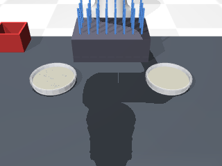
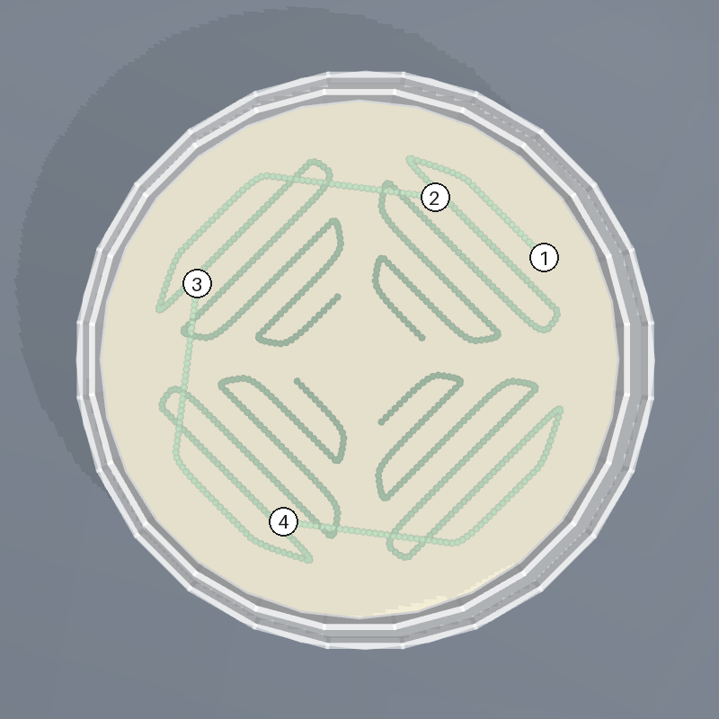
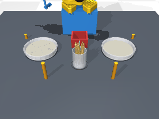
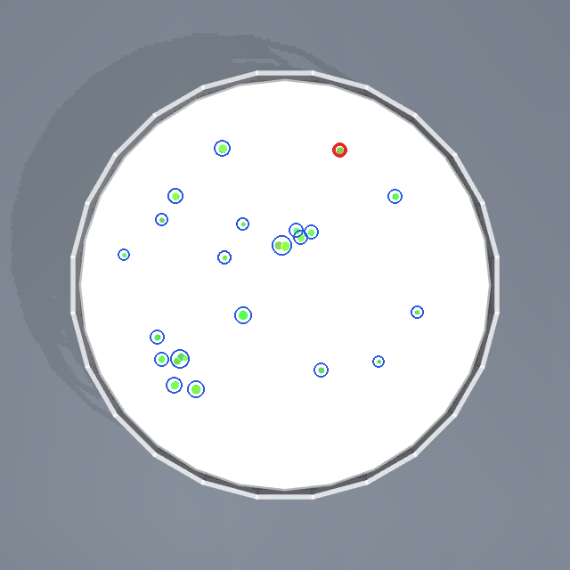
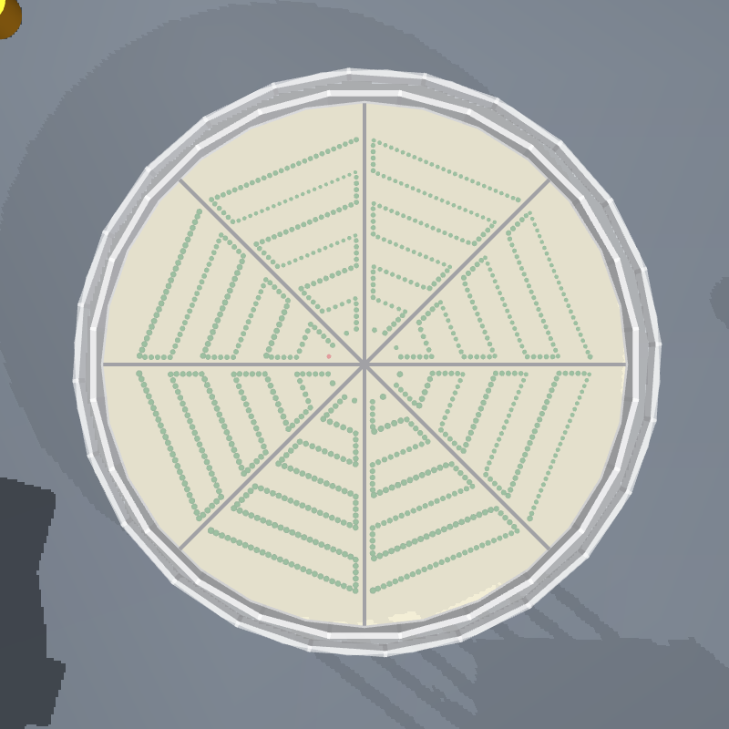
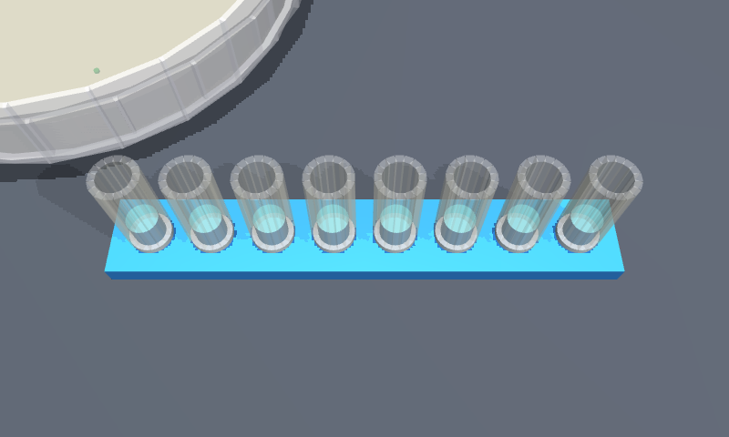
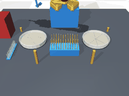
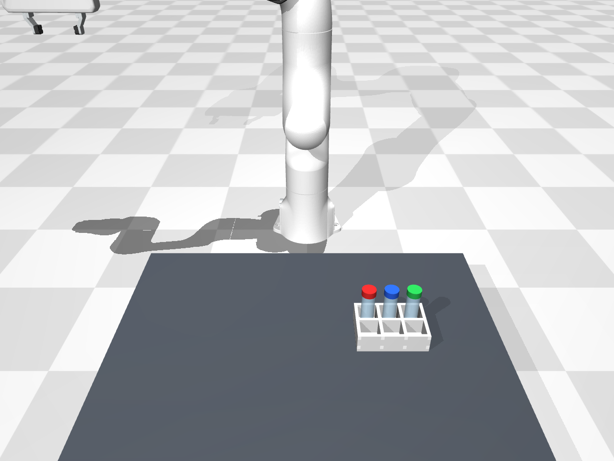

# MuJoCo Lab Sim

Simulation of robotic colony picking, restreaking and colony PCR for cyanobacteria, built in MuJoCo as part of a sim-to-real / real-to-sim project inspired by Gemini 4 Hydrogen for robotics.

Commercial colony pickers (e.g. QPix) are optimized for *E. coli*, and no current system restreaks from plate to plate. This project asks whether a robot can perform the cyanobacterial strain workflow, and what hardware it would need. Two robots are compared:

| | **Reference** (Franka Panda) | **Build** (SO-101) |
|---|---|---|
| Robot | Lab-grade 7-joint research arm | Low-cost 3D-printed 5-joint arm |
| Question | Is the workflow feasible for a robot? | Is it feasible with hardware a lab could build? |
| Lid handling | Suction pad | Custom printed jaw with a V-shaped lid hook |
| Tools | Loop or toothpick, 24-slot rack | Toothpicks in a cup (agitated to free one) or a printed 24-hole rack |
| Motors | Ideal, gravity compensated | Realistic servo torque, no gravity compensation, joint calibration error corrected by touch calibration |
| Restreak success | 20/20 | Cup 2/8, rack **8/8** |
| Colony PCR | 31/31 colonies | 31/31 colonies |

Sections: [1. Reference version](#1-reference-version-franka-panda), [2. Build version](#2-build-version-so-101), [3. Colony PCR](#3-colony-pcr), [4. Connected lab version](#4-connected-lab-version-lab-protocol), [5. Vial pick-and-place](#5-vial-pick-and-place-warm-up).

## 1. Reference version (Franka Panda)



| Colony detection (red: selected, most isolated) | Streak path (numbers: quadrant start; light to dark: stroke order; red: loss of contact) |
|---|---|
|  |  |

### Workflow

1. Remove both lids and set them aside.
2. Image the source plate from above and detect colonies.
3. Select the most isolated colony to ensure a single-colony pick.
4. Take the next tool from a 24-slot rack: plastic loop or wooden toothpick. The gripper opens only 3 mm wider than the handle and lifts the tool its full length before moving, so neighboring tools are never touched.
5. Lower the tool onto the selected colony until contact is sensed. This also measures the agar surface height, which varies between plates.
6. Quadrant streak the fresh plate. Each quadrant is streaked from the rim toward the center, starting from the previous quadrant, at about 0.3 mm press depth.
7. Discard the tool and replace both lids.

### Usage

```bash
~/.venvs/mujoco-lab/bin/python streak_plate.py                       # prompts for loop or toothpick
~/.venvs/mujoco-lab/bin/python streak_plate.py --tool toothpick --seed 3
~/.venvs/mujoco-lab/bin/python run_trials.py --trials 10             # randomized plates, both tools
```

`--seed` changes the colony layout and agar thickness.

### Results

10 randomized plates per tool (colony layout, agar thickness and rack slot vary). Data: [`outputs/trials.csv`](outputs/trials.csv).

| | Plastic loop | Wooden toothpick |
|---|---|---|
| Full workflow | 10/10 | 10/10 |
| Tool retrieved without contacting neighbors | 10/10 | 10/10 |
| Single-colony pick | 10/10 | 10/10 |
| Maximum distance from colony center | 0.12 mm | 0.13 mm |
| Streak contact with agar | 100% | 100% |
| Maximum press depth (limit 1 mm) | 0.49 mm | 0.36 mm |
| Peak streaking force | 0.30 to 0.58 N | 0.06 to 0.12 N |
| Agar height error (touch sensing) | ≤ 0.26 mm | ≤ 0.21 mm |
| Time per plate | ~175 s | ~174 s |

Colony detection found 21 to 28 colonies per plate. Missed colonies were contiguous colonies merged into one object; only isolated colonies are picked.

**Interpretation:** motion, vision and contact control do not limit plate-to-plate restreaking with either tool. The simulation is idealized (uniform lighting, calibrated camera, round colonies, no tool slip), so these results are an upper bound.

**Hardware requirements identified:**
- **Gravity compensation.** Without it, the tool landed ~5 mm off target.
- **Suction for lids.** A 90 mm lid exceeds the 80 mm gripper stroke.
- **A toothpick adapter.** The gripper cannot hold a bare 2 mm toothpick securely.
- **Agar surface sensing.** Agar thickness varies by more than 1.5 mm between plates.
- **Tool rack geometry.** ~3 cm spacing along the gripper's closing axis, a deep rack for 12 cm loops, and a full-length vertical lift before lateral motion. With these, all 48 test retrievals (every slot, both tools) were contact-free.

### Scope and assumptions

The simulation tests whether a robot can perform the physical steps reliably: locating colonies, contacting a 1 mm target, following the agar surface without gouging, and handling lids. Biological transfer and growth are not modeled.

| Assumption | Rationale |
|---|---|
| 89 mm × 15 mm plate; agar 5.5 to 7.2 mm thick, randomized | Standard round Petri dish, filled to about half height |
| Colonies 0.8 to 2 mm, scattered and clustered | Visible colonies, with crowding so isolation matters |
| Lids lifted by a fingertip suction pad | Lid wider than the gripper stroke; commercial plate handlers use suction or delidders |
| Tool locked to the gripper once grasped | Represents a tool adapter; simulated fingers do not hold thin sticks reliably |
| Toothpick held in a 4 mm sleeve | Panda fingertips cannot close on a bare 2 mm toothpick |
| 3 × 8 tool rack: 3 cm pitch along the closing axis, 2 cm across; 6 cm deep for loops, 3.5 cm for toothpicks | Tighter spacing caused finger contact; shallow racks let 12 cm loops lean into the gripper path |
| Plates fixed in nests | Prevents plates sliding during streaking |
| Gravity compensation enabled | Without it the arm sags ~5 mm; Franka arms compensate in practice |
| Grading against hidden ground truth (true colony positions and agar height) | Metrics reflect actual performance, not the robot's own estimate |

## 2. Build version (SO-101)



| Colony detection | Streak path |
|---|---|
|  |  |

```bash
~/.venvs/mujoco-lab/bin/python streak_plate.py --robot so101 --seed 2
~/.venvs/mujoco-lab/bin/python run_so101_trials.py --trials 8
```

### Design

1. **Two-zone printed jaw** ([`build_so101_model.py`](build_so101_model.py)). Slim fingertips (4 × 6 mm) pick a single toothpick; a V-shaped hook on the moving jaw grips the lid rim at a jaw angle of 1.70 rad. No suction.
2. **Touch calibration.** At startup the arm touches 4 pins at known positions (2 short, 2 tall) from above and from four sides, 20 contacts in total, and solves for each joint's offset. Tool position error drops from 0.4 to 2.3 mm to 0.07 to 0.16 mm. Takes ~3 min per session.
3. **Lid handling by touch.** The fixed fingertip descends 4 mm outside the rim and advances until contact is sensed (servo load); the V-hook then closes and centers the lid. On replacement, if the lid rests on the rim, a spiral search seats it.
4. **Toothpicks from a cup**, as kept by hand. 24 toothpicks in a 3.2 cm holder with a printed tab. A depth camera locates toothpick tops and estimates each one's tilt; the robot picks one with clearance for the fingertips, lifts vertically and verifies that no neighbor came with it. If none has clearance, the arm grips the tab and swirls the cup gently (1.5 to 3.5 mm, increasing each round), then re-images.
5. **Safe travel height.** Lateral moves are made at a safe height (higher when holding a toothpick) along an arc around the base. Low moves previously let the open lid hook knock 1 to 3 toothpicks out of the cup per run.
6. **Visual correction before contact.** The toothpick hovers 4.5 mm above the colony, the plate camera locates the tip, and the position is corrected before contact.
7. **Realistic actuators.** SO-101 servo torque (2.94 Nm), no gravity compensation, and an unknown calibration error of up to 0.5° per joint, randomized per seed.

### Results: cup

8 randomized plates (colonies, agar, toothpick arrangement and calibration error vary). Data: [`outputs/so101_trials.csv`](outputs/so101_trials.csv).

| Step | Success | Notes |
|---|---|---|
| Calibration | 8/8 | Tool error 0.4 to 2.3 mm before, 0.07 to 0.16 mm after |
| Single toothpick retrieved | 5/8 | 0 to 7 agitation rounds when successful; 3 plates yielded none after 14 rounds |
| Single-colony pick | 5/5 | 0.08 to 0.33 mm from colony center (up to 3.5 mm before calibration) |
| Streak (press depth limit 1 mm) | 5/5 | 100% contact, maximum depth 0.86 mm |
| Lids replaced | 2/5 | Lid not re-gripped from its parking position |
| **Full workflow** | **2/8** | ~7 min per plate, including calibration |

Calibration brings the SO-101's accuracy to the Panda's level. The limiting step is the cup: toothpick tops remain crowded, and gentle agitation (lateral, tapping and swirling were tested) rarely isolates one.

### Results: printed rack

A printed rack holds each toothpick separately: two rows of 12 holes, 7 mm pitch (clearance for the 6 mm fingertips), rows 2.5 cm apart (clearance for the trailing fingertip and lid hook), holes 2.5 cm deep, leaving 4 cm of each toothpick exposed.


```bash
~/.venvs/mujoco-lab/bin/python streak_plate.py --robot so101 --holder rack --seed 0
~/.venvs/mujoco-lab/bin/python run_so101_trials.py --trials 8 --holder rack
```

| Step | Cup | **Rack** |
|---|---|---|
| Calibration (tool error after) | 0.07 to 0.16 mm | 0.07 to 0.16 mm |
| Toothpick retrieved on first attempt | 2/8 (3 never) | **8/8**, no neighbor contact |
| Single-colony pick | 5/5, 0.08 to 0.33 mm | **8/8**, 0.07 to 0.17 mm |
| Streak (depth limit 1 mm) | 5/5 | **8/8**, maximum 0.92 mm |
| Lids replaced | 2/5 | **8/8** |
| **Full workflow** | **2/8** | **8/8** |

Data: [`outputs/so101_rack_trials.csv`](outputs/so101_rack_trials.csv). With a rack, the SO-101 matches the Panda on this workflow. Relocating the waste bin within reach also resolved the lid failures, which followed from an awkward arm pose after discarding.

### Design lessons

Each came from a failure in simulation:

- **8 cm riser.** Pointing straight down, the SO-101 reaches only ~7 cm above its base, too low to lift a toothpick out of a cup.
- **No 12 cm loops.** An upright loop is too tall to lift out of a cup; toothpicks only.
- **Narrow, deep cup.** In a wide cup, 6.5 cm toothpicks fall flat; in a 3.2 × 4.5 cm holder they rest against the rim with tops ~6 mm apart.
- **Fingertips under 6 mm wide**, to fit between toothpick tops.
- **Stop at first contact.** Full servo force ejects a tilted toothpick sideways; a grooved fingertip is needed (modeled as a hold that engages when both fingertips contact the same toothpick).
- **Lid hook orientation.** With the jaw nearly closed, the hook sits 5.7 cm behind the fingertips at fingertip height. It must face away from the cup or it contacts the toothpicks.
- **Remove the wrist camera mount.** It collides with the shoulder when the arm folds in toward the base.
- **V-shaped hook.** A flat hook holds the lid up to 7 mm off center; a V centers it.
- **Touch calibration.** 0.5° per joint becomes 1 to 3 mm at the tool tip, enough to miss a 1 mm colony; calibration brings it under 0.2 mm. Pins of different heights are required, otherwise shoulder, elbow and wrist offsets cannot be distinguished.
- **Travel high.** The open lid hook extends 10 cm past the fingertips and dislodged toothpicks during low moves.
- **Cup tab and a low bench ring.** Fanned toothpicks block access to the cup wall, so the cup is agitated by a tab; a tab resting on the ring tilted the cup 4.6°.
- **Agitation does not decongest a crowded cup.** All three motions left about one pickable toothpick per image, often none.

### Known limitations

- Cup holder: 3 of 8 plates yielded no isolated toothpick. Use the rack.
- When the gripper occludes the toothpick tip, visual correction is skipped; with calibration, picks remain within 0.33 mm.

## 3. Colony PCR

For each of up to 8 colonies:

1. Take a fresh toothpick from the rack.
2. Pick a different isolated colony.
3. Patch it onto position k of the fresh plate, retaining a viable copy of the clone.
4. Resuspend the remaining cells in PCR tube k of an 8-tube strip (three small swirls in the master mix).
5. Discard the toothpick.

Colony k → patch k → tube k, so each PCR result traces to a retained clone.


```bash
~/.venvs/mujoco-lab/bin/python run_pcr.py --robot so101 --seeds 0 1 2 3
~/.venvs/mujoco-lab/bin/python run_pcr.py --robot panda --seeds 0 1 2 3
```

| | Panda | SO-101 (rack) |
|---|---|---|
| Colonies completed (pick, patch, resuspend) | **31/31** | **31/31** |
| Distance from colony center | 0.01 to 0.13 mm | 0.07 to 0.22 mm |
| Patch contact with agar | 100% | 100% |
| Tip below master-mix level, correct tube | 31/31, 2.5 mm deep | 31/31, 2.7 to 2.8 mm deep |
| Contact with another tube | none | none |
| Lids replaced | 3/4 | 4/4 |
| Time for 8 colonies | ~8 min | ~12 min (incl. 3 min calibration) |

4 randomized plates per robot; one plate had only 7 isolated colonies (31 total). Data: [`outputs/pcr_panda_results.json`](outputs/pcr_panda_results.json), [`outputs/pcr_so101_results.json`](outputs/pcr_so101_results.json).

Notes:
- The Panda's lid failure occurred once: the lid adhered to the fingertips when suction was released and flipped. It did not recur on a rerun and reflects the simplified suction model.
- Liquids are not simulated. Resuspension is scored as the tip reaching at least 1 mm below the master-mix level in the correct tube.
- **Merged colonies.** Three contiguous colonies were detected as one object and picked together, which would yield a mixed clone. Detection now rejects objects that are elongated or larger than a single colony (> 2.2 mm). On 6 plates, it rejected 10/10 merged objects and 0/129 single colonies. The restreak trials in sections 1 and 2 predate this change; all of their picks were confirmed single-colony.

## 4. Connected lab version (lab protocol)

The colony PCR protocol as performed in the lab, for 8 colonies:

1. A sticker beneath the fresh plate divides it into 8 sectors.
2. For each colony, using one toothpick: pick a generous amount of cells with one end, invert the toothpick, and lightly touch the colony with the other end, so both ends carry cells.
3. With the heavily loaded end, streak a zigzag within the colony's sector, from the rim toward the center.
4. With the lightly loaded end, resuspend cells in PCR tube k by rolling the toothpick in the master mix. A very slight green tint indicates the right amount of cells.
5. Discard and repeat for all 8 colonies.

### Finding: neither robot can invert the toothpick in-hand

A person inverts the toothpick between their fingers. A gripper normally points straight down, so the upper end can never be used. In-hand inversion requires holding the toothpick horizontally across the gripper (gripper horizontal, toothpick vertical) and rotating the wrist 180°.

| | SO-101 | Panda |
|---|---|---|
| Horizontal gripper near the bench? | **No.** With 5 joints, the gripper axis is confined to the vertical plane through the base. A horizontal, outward-facing gripper places the wrist ~16 cm back, over the base; no target (plates, PCR tubes, regrasp stand) was reachable | **Yes.** With 7 joints, all targets are reachable horizontally with either end down |
| Does the hand clear the bench? | (not reachable) | **No.** The fingers are 22 mm thick, but the hand is 88 mm thick (44 mm on each side of the grip point). Holding a 6.5 cm toothpick at its midpoint, the hand would sit ~1 cm below the bench and plate walls |

Possible solutions:
- **Inversion station:** a printed clip on a hinge, rotated 180° by a servo, holding the toothpick at its midpoint so neither end makes contact. Preserves the protocol exactly.
- **A thinner gripper or longer toothpick**, so the hand clears the bench when held horizontally.
- **A protocol without inversion** (tested below).

### Single-pick protocol

The colony is picked once, and the same end is used for both the streak and the PCR, so the PCR receives the cells remaining after streaking. For each of 8 colonies:

1. Take a fresh toothpick from the rack.
2. Pick the colony.
3. Streak a zigzag within sector k, from the rim toward the center.
4. Resuspend the remaining cells in PCR tube k (three swirls in the master mix).
5. Discard.

```bash
~/.venvs/mujoco-lab/bin/python run_connected_lab.py --robot so101 --seeds 0 1 2 3
~/.venvs/mujoco-lab/bin/python run_connected_lab.py --robot panda --seeds 0 1 2 3
```

| Fresh plate: 8 sectors, each streaked rim to center | PCR strip: master mix tinted by the cells released |
|---|---|
|  |  |

4 randomized plates per robot; one plate had only 7 isolated colonies (31 total). Data: [`outputs/connected_so101_results.json`](outputs/connected_so101_results.json), [`outputs/connected_panda_results.json`](outputs/connected_panda_results.json).

| | Panda | SO-101 (rack) |
|---|---|---|
| **Colonies completed** (single-colony pick, streak within its sector, slight-green tube, no other tube contacted) | **31/31** | **31/31** |
| Distance from colony center | 0 to 0.13 mm | 0.07 to 0.22 mm |
| Streak contact with agar | 100% | 99 to 100% |
| Maximum press depth (limit 1 mm) | 0.38 mm | 0.92 mm |
| Streak confined to its sector | 31/31 | 31/31 |
| Tube color | 31/31 slight green | 31/31 slight green |
| Lids replaced | 4/4 | 4/4 |
| Time for 8 colonies | ~9 min | ~13 min (incl. 3 min calibration) |



The single-pick protocol is feasible on both robots without inversion.

These runs also showed discarded toothpicks leaning out of the 3 cm waste bin onto the bench. The SO-101 now lowers each toothpick into a tall, narrow waste cup (5 cm wide, 8 cm tall) before release, positioned clear of the lid hook's path during resuspension (the first position blocked 7 of 8 resuspensions). In the final runs, all 31 toothpicks landed in the cup.

**Are enough cells left for the PCR?** This depends on how quickly the toothpick loses cells during streaking, which the simulation cannot determine. The model assumes the tip retains `exp(-L / d)` of its load after streaking a length `L`. For the 122 mm streak:

| Assumed d (streak length at which 63% of cells are deposited) | Cells released | Tube | Streak length for mid-band tint |
|---|---|---|---|
| 30 mm | 0.01 | too little | 53 mm |
| 40 mm | 0.04 | too little | 71 mm |
| **60 mm (used in the runs)** | **0.11** | **slight green** | 106 mm |
| 80 mm | 0.19 | slight green | 141 mm |
| 100 mm | 0.26 | slight green | 176 mm |
| 120 mm | 0.32 | too green | 212 mm |

The remaining cells fall within the target range for d ≈ 45 to 115 mm. If cells are depleted faster, a shorter streak (fewer strokes) compensates, with the required length given above. **Calibration experiment:** perform the single-pick protocol on several colonies, photograph the tubes, and compare their tint with tubes prepared by the standard protocol. The tint gives d, which sets the streak length.

## 5. Vial pick-and-place (warm-up)


| Before | After |
|---|---|
|  |  |

```bash
~/.venvs/mujoco-lab/bin/python pick_and_place.py
```

3/3 vials placed, each within 0.4 mm of the slot center.

## Setup

```bash
python3 -m venv ~/.venvs/mujoco-lab
~/.venvs/mujoco-lab/bin/pip install -r requirements.txt
```

The environment is kept outside the synced project folder. Interactive viewer for the vial scene (drag to rotate, Ctrl+drag to apply force):

```bash
~/.venvs/mujoco-lab/bin/python -m mujoco.viewer --mjcf=models/lab_scene.xml
```

## Files

| File | Contents |
|---|---|
| `plate_world.py` | Panda scene: plates, lids, agar, randomized colonies, 24-tool rack, waste bin, cameras |
| `cyano_sim.py` | Panda workflow: lid handling, colony detection, surface sensing, quadrant streak, grading |
| `so101_world.py` | SO-101 scene: compact layout, riser, toothpick cup or rack, calibration pins, waste cup |
| `so101_sim.py` | SO-101 workflow: touch calibration, lid hook, toothpick retrieval, visual correction |
| `build_so101_model.py` | Generates `models/so101_lab.xml`: Menagerie SO-101 with the custom printed jaw |
| `streak_plate.py` | Runs one plate (`--robot panda` or `--robot so101`) and saves images and a GIF |
| `run_trials.py`, `run_so101_trials.py` | Randomized trials (`--holder cup` or `rack` for the SO-101) |
| `pcr.py`, `run_pcr.py` | Colony PCR: pick, patch, resuspend in an 8-tube PCR strip |
| `connected_lab.py`, `run_connected_lab.py` | Connected lab version: single pick, sector streak, resuspension, cell-amount model |
| `lab_sim.py` | Shared inverse kinematics, motion and rendering |
| `pick_and_place.py`, `models/lab_scene.xml` | Vial demo |
| `models/panda_lab.xml` | Menagerie Panda with a grip site and gravity compensation |
| `assets/franka_emika_panda/`, `assets/robotstudio_so101/` | Unmodified MuJoCo Menagerie models (meshes, licenses) |

## Next steps

1. Build the SO-101 with the printed jaw and rack, and compare real and simulated success rates (sim-to-real gap).
2. Measure cell depletion during streaking (tube tint after the single-pick protocol) to set the streak length.
3. Analyze PCR results (gel images), then inoculate confirmed patches into liquid culture.
4. Real-to-sim: evaluate colony detection on photographs of real cyanobacterial plates.
5. Compare colony selection by `gemini-4-hydrogen` from camera images against the current detector.
