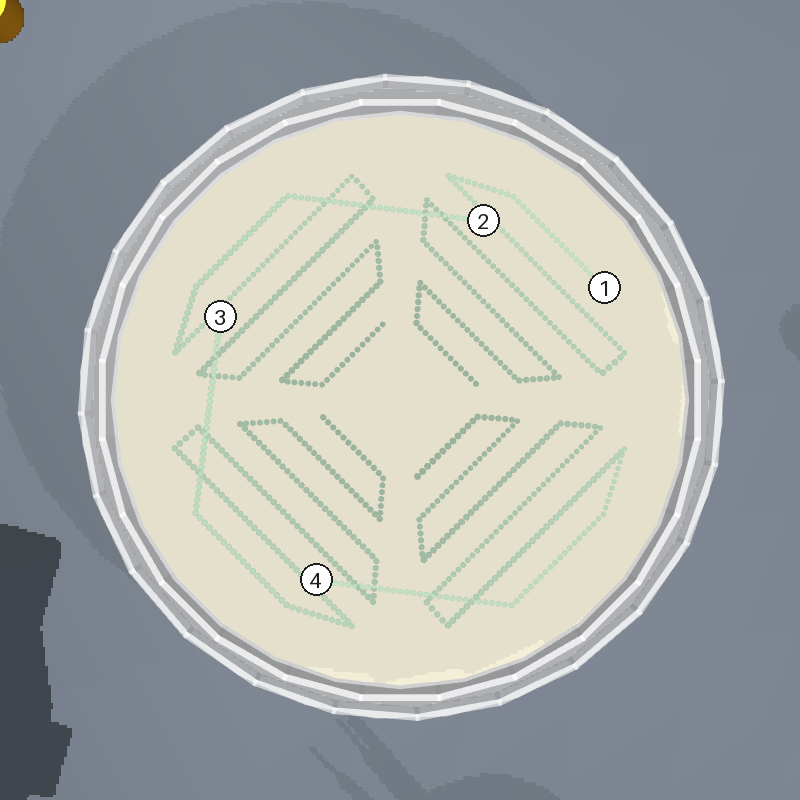
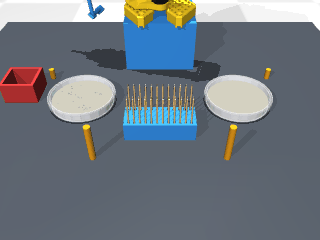
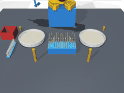

# MuJoCo Lab Sim

Simulated lab automation in MuJoCo, part of a sim-to-real / real-to-sim project inspired by Gemini 4 Hydrogen for robotics.

**Main project: cyanobacteria colony picking and quadrant restreaking**, a workflow a cyano researcher wants automated. Today's colony pickers (like the QPix) are built for E. coli, and no robot streaks from plate to plate. Two versions:

| | **Reference** (Panda) | **Build** (SO-101) |
|---|---|---|
| Robot | Franka Panda, a lab-grade 7-joint research arm | SO-101, a cheap 3D-printed 5-joint arm |
| Question | Can a robot do this workflow at all? | Can something you could actually build do it? |
| Lids | Suction pad | Our printed jaw with a V-shaped lid hook |
| Tools | Loop or toothpick from a 24-slot rack | Toothpicks jumbled in a cup (shake to free one), or a printed 24-hole rack |
| Motors | Ideal (gravity compensated) | Realistic: weak servos, no gravity compensation, hidden calibration error fixed by touch calibration |
| Full restreak success | 20/20 | Cup 2/8, **rack 8/8** |
| Colony PCR (8 per plate) | 31/31 colonies | 31/31 colonies |
| Sections | [1](#1-reference-version-panda) | [2](#2-build-version-so-101) |

Then **colony PCR** on both robots ([3](#3-colony-pcr-both-robots)), and a warm-up vial demo ([4](#4-vial-rack-pick-and-place-warm-up)).

## 1. Reference version (Panda)


| Colony finder (red = chosen, most isolated) | Streak on the fresh plate (numbers = quadrant start, light to dark = stroke order, red would mean lifted off) |
|---|---|
|  |  |

### What the robot does

1. Lifts the lids off both plates and parks them on the bench.
2. Photographs the source plate from above and finds every colony (green dot).
3. Chooses the colony with the most empty space around it, so it picks a single clean colony.
4. Takes the next tool from a **24-slot rack** (like a pipette tip box): a **plastic loop** or a **wooden toothpick** (you choose). It opens the fingers only 3 mm wider than the handle and lifts the tool straight up by its full length, so it never touches the neighbors.
5. Lowers the tool slowly until it feels the agar, touching down on the chosen colony. This also measures the agar height, which changes from plate to plate.
6. Quadrant streaks the fresh plate. In each quadrant it zigzags from the rim in toward the center, and each new quadrant starts by dragging out of the previous one. It presses about 0.3 mm into the agar the whole way so it never digs in.
7. Drops the tool in the waste bin and puts both lids back.

### Run it

```bash
~/.venvs/mujoco-lab/bin/python streak_plate.py
```

It asks which tool to use (1 = plastic loop, 2 = wooden toothpick). Or pass it directly:

```bash
~/.venvs/mujoco-lab/bin/python streak_plate.py --tool toothpick --seed 3
```

`--seed` changes the colony layout and agar thickness. To test many random plates with both tools:

```bash
~/.venvs/mujoco-lab/bin/python run_trials.py --trials 10
```

### Results

10 random plates per tool (different colony layouts, agar thickness and rack slot every time). Full table: [`outputs/trials.csv`](outputs/trials.csv).

| | Plastic loop | Wooden toothpick |
|---|---|---|
| Full workflow success | 10/10 | 10/10 |
| Took a tool from the rack without touching a neighbor | 10/10 | 10/10 |
| Touched a single clean colony | 10/10 | 10/10 |
| Worst miss from colony center | 0.12 mm | 0.13 mm |
| Streak in contact with agar | 100% | 100% |
| Deepest press into agar (limit 1 mm) | 0.49 mm | 0.36 mm |
| Peak streaking force | 0.30 to 0.58 N | 0.06 to 0.12 N |
| Agar height found by touch, error | within 0.26 mm | within 0.21 mm |
| Time per plate (lids off to lids back on) | about 175 s | about 174 s |

The colony finder caught 21 to 28 colonies per plate. The ones it missed were dots touching inside clumps, which merge into one blob. That's fine here, because the robot only picks isolated colonies.

**What this means:** in simulation, nothing in the motion, vision or contact control blocks a robot from doing plate-to-plate cyano restreaking with either tool. The sim is idealized, though: perfect lighting, a perfectly calibrated camera, colonies that are always clean dots, and a tool that never slips. Real plates will be harder, so these numbers are an upper bound.

Getting here surfaced real hardware requirements:
- **Gravity compensation is required.** Without it, the arm landed about 5 mm off, which is enough to miss every colony.
- **A 90 mm lid needs suction.** It's wider than a standard parallel gripper opens.
- **A toothpick needs an adapter.** A standard gripper can't hold a bare 2 mm stick securely.
- **Touch-sensing the agar is needed.** Agar thickness varies by more than 1.5 mm between plates.
- **The tool rack has design rules.** Tools need about 3 cm of space in the direction the fingers close, tall loops need a deep rack, and the arm has to lift each tool its full length before moving sideways. With those rules, all 48 test picks (every slot, both tools) came out without touching a neighbor.

### What the sim does and does not show

The sim tests whether **a robot can physically do the steps** reliably: see the colonies, touch a 1 mm target, follow a varying agar surface without gouging, and handle lids. It cannot test the biology: whether cyano cells actually stick to the tool, transfer, and grow. That needs real plates.

Modeling choices worth knowing:

| Choice | Why |
|---|---|
| Plate: 89 mm across, 15 mm tall. Agar 5.5 to 7.2 mm thick (up to about half the plate height), random per plate | Standard round microbial plate |
| Colonies: green dots 0.8 to 2 mm across, some scattered, some in clumps | "Visible dots," with real crowding so isolation matters |
| Lids are lifted with a small suction pad at the fingertips | A 90 mm lid is wider than the Panda gripper opens (80 mm). Real plate-handling robots use suction or a delidder |
| The tool is locked to the gripper once grasped (a tool adapter) | The simulated fingers do not grip thin sticks well, and real cells use adapters anyway |
| The toothpick sits in a 4 mm sleeve | The Panda fingertips cannot close tightly on a bare 2 mm toothpick. A real setup would need the same kind of adapter |
| Tools stand in a 3 x 8 rack: 3 cm apart where the fingers close, 2 cm apart the other way. The loop rack is 6 cm deep, the toothpick rack 3.5 cm | At 2 cm spacing the Panda's thick fingers hit neighbors. In a shallow rack the 12 cm loops lean into the fingers' path. A bump counts whenever the robot or its tool touches another tool |
| Plates are fixed in nests on the bench | Plates would slide while being streaked otherwise |
| Arm uses gravity compensation | Without it the arm sags about 5 mm, too much for 1 mm colonies. Real Franka arms compensate too |
| Grading uses hidden "truth" (real colony positions, real agar height) that the robot never sees | So the numbers measure what the robot actually achieved |

## 2. Build version (SO-101)


| Colony finder | Streak on the fresh plate |
|---|---|
|  |  |

```bash
~/.venvs/mujoco-lab/bin/python streak_plate.py --robot so101 --seed 2
~/.venvs/mujoco-lab/bin/python run_so101_trials.py --trials 8
```

### What is different

1. **Our printed two-zone jaw** ([`build_so101_model.py`](build_so101_model.py)). Slim fingertips (4 mm thick, 6 mm wide) pick a single toothpick. A V-shaped hook on the swinging jaw grips the lid by its rim when the jaw is opened 1.70 rad. No suction.
2. **Calibration by touch.** At startup the arm touches 4 pins at known spots (2 short, 2 tall), from the top and all four sides: 20 touches. It then solves for each joint's error. This cut the tool error from 0.4 to 2.3 mm down to 0.07 to 0.16 mm. It takes about 3 minutes, once per session.
3. **Lids by touch.** The fixed fingertip comes down 4 mm outside the rim and slides in until it feels the rim (servo load). Then the V-hook closes, which also centers the lid sideways. To put a lid back, the arm lowers it, and if it stops high (resting on the rim) it does a small spiral search until it drops in.
4. **Toothpicks from a cup, the way a person keeps them.** 24 toothpicks lean together in a 3.2 cm holder with a printed grab tab. A depth camera finds toothpick tops (local high points) and works out each stick's lean and direction. The robot picks one where the fingertips fit between the neighbors, pulls straight up, and checks that no other toothpick came with it. **If none has room, the arm pinches the cup's tab and swirls it gently**, a little stronger each round (1.5 to 3.5 mm), then looks again.
5. **Never sweep low.** Every sideways move first rises to a safe height, higher when carrying a toothpick, and arcs around the robot base. Before this, the open lid hook was knocking 1 to 3 toothpicks out of the cup every run.
6. **Look before touching.** The toothpick hovers 4.5 mm over the colony, the plate camera finds the tip's lowest point, and the robot corrects before it touches.
7. **Realistic motors.** Menagerie's SO-101 servo strength (2.94 N*m), no gravity compensation, and a hidden calibration error of up to 0.5 degrees per joint, different for every seed.

### Results (cup version)

8 random plates. Each seed changes the colonies, agar, how the toothpicks fall, and the arm's hidden calibration error. Full table: [`outputs/so101_trials.csv`](outputs/so101_trials.csv). Watch a run step by step with `run_so101_trials.py`: it prints every action live.

| Step | Success | Notes |
|---|---|---|
| Calibration | 8/8 | Tool error 0.4 to 2.3 mm before, 0.07 to 0.16 mm after |
| One toothpick out of the cup | 5/8 | 0 to 7 gentle shakes when it works. 3 plates had no free toothpick even after 14 shakes |
| Clean colony touch | 5/5 picked | **0.08 to 0.33 mm** from the colony center (was up to 3.5 mm before calibration) |
| Streak (no gouging, limit 1 mm) | 5/5 | 100% contact, deepest 0.86 mm |
| Lids back on | 2/5 | The lid could not be picked back up from its parking spot ("hook never closed"). Not yet diagnosed |
| **Full workflow** | **2/8** | About 7 minutes per plate including calibration |

**What this means:** calibration fixed the cheap arm's accuracy. Colony touches and streaks are now as good as the Panda's. What's left is the cup itself: **in a jumbled cup the toothpick tops stay crowded together, and gentle shaking rarely frees one** (side-to-side, tapping and swirling were tested; none reliably did). That's the motivation for the rack variant: a printed rack that holds each toothpick on its own, the same idea as the Panda's tool rack.

### Rack variant: a printed toothpick rack

In a jumbled cup the toothpick tops stay crowded, so the robot often has nothing it can grab. The fix is the same idea as the Panda's tool rack: **print a rack that holds each toothpick on its own.** Two rows of 12 holes, 7 mm apart along a row (room for the 6 mm fingertips), rows 2.5 cm apart (the fingertip behind the toothpick and the lid hook clear the other row), holes 2.5 cm deep so 4 cm of each toothpick sticks up.



```bash
~/.venvs/mujoco-lab/bin/python streak_plate.py --robot so101 --holder rack --seed 0
~/.venvs/mujoco-lab/bin/python run_so101_trials.py --trials 8 --holder rack
```

| Step | Cup | **Rack** |
|---|---|---|
| Calibration (tool error after) | 0.07 to 0.16 mm | 0.07 to 0.16 mm |
| One toothpick, first try | 2/8 (3 never) | **8/8**, zero neighbors touched |
| Clean colony touch | 5/5 picked, 0.08 to 0.33 mm | **8/8, 0.07 to 0.17 mm** |
| Streak (limit 1 mm deep) | 5/5 | **8/8**, deepest 0.92 mm |
| Lids back on | 2/5 | **8/8** |
| **Full workflow** | **2/8** | **8/8** |

Full table: [`outputs/so101_rack_trials.csv`](outputs/so101_rack_trials.csv). With a rack, the cheap printed arm matches the lab-grade Panda on this workflow. The other change between the two runs was moving the waste bin within reach. Before that, the arm ended its drop in an awkward pose, and that also caused the lid failures.

### What building it in the sim taught us

Every one of these came from the sim failing first:

- **The SO-101 needs an 8 cm riser.** Pointing straight down, it can only reach about 7 cm above its own base, too low to lift a toothpick out of a cup.
- **12 cm loops do not work** with this arm and a cup. A loop held upright is too tall to lift out. Toothpicks only.
- **A narrow, deep cup.** In a wide cup, 6.5 cm toothpicks fall flat. In a 3.2 cm by 4.5 cm holder they lean on the rim and their tops fan out about 6 mm apart.
- **Fingertips narrower than 6 mm.** Wider tips never fit between toothpick tops.
- **Stop squeezing at first contact.** Full servo force squirts a tilted toothpick out sideways. A real fingertip needs a small groove to catch the stick. The sim models that groove as a hold that switches on when both fingertips touch the same stick.
- **Where the lid hook sits matters.** The hook swings down as the jaw opens a little, so with the jaw gripping a toothpick it hangs 5.7 cm behind the fingertips at fingertip height. It must face away from the cup, or it lands on the toothpicks and blocks the jaw.
- **Remove the wrist camera mount.** It hits the SO-101's shoulder when the arm folds in to reach colonies near the base.
- **Use a V-shaped hook.** A flat hook holds the round lid wherever it lands, up to 7 mm sideways. A V centers it.
- **Calibration error is the cheap arm's real problem**, and touch calibration fixes it. 0.5 degrees per joint becomes 1 to 3 mm at the tool tip. Touching 4 pins brings it under 0.2 mm. Use pins of different heights: with same-height pins the shoulder, elbow and wrist errors look alike and cannot be separated.
- **Travel high.** An open lid hook reaches 10 cm past the fingertips. Moving low across the bench, it knocked toothpicks out of the cup every run.
- **Give the cup a grab tab, and keep the bench ring low.** The fingertips cannot reach the cup wall through the fanned-out toothpicks, so the arm shakes the cup by a tab sticking out toward it. A tab resting on the ring tilted the cup 4.6 degrees.
- **Shaking does not spread a crowded cup.** Side-to-side, tapping and swirling all left about one pickable toothpick per look, often none.

### Known limits

- Cup version: 3 of 8 cups never gave up a free toothpick. Use the rack variant.
- When the gripper blocks the camera's view of the toothpick tip, the robot skips the camera correction. With calibration this matters much less (touches still within 0.33 mm).

## 3. Colony PCR (both robots)

The third step of the cyano workflow. For each of up to 8 colonies, the robot:

1. takes a fresh toothpick (Panda rack or SO-101 printed rack),
2. touches a different isolated, single colony,
3. **patches** it onto spot k of the fresh plate, so a living copy of that clone is kept,
4. **dips** it into PCR tube k of an 8-tube strip and swirls three small circles in the master mix,
5. drops the toothpick in the waste bin.

Colony k -> patch k -> tube k, so every PCR result traces back to a clone you still have.



```bash
~/.venvs/mujoco-lab/bin/python run_pcr.py --robot so101 --seeds 0 1 2 3
~/.venvs/mujoco-lab/bin/python run_pcr.py --robot panda --seeds 0 1 2 3
```

| | Panda | SO-101 (rack) |
|---|---|---|
| Colonies done correctly (pick + patch + dip) | **31/31** | **31/31** |
| Colony touch, distance from center | 0.01 to 0.13 mm | 0.07 to 0.22 mm |
| Patch contact with the agar | 100% every time | 100% every time |
| Tip below the master-mix level, right tube | 31/31, 2.5 mm deep | 31/31, 2.7 to 2.8 mm deep |
| Touched another tube (cross-contamination) | never | never |
| Lids back on | 3/4 plates | 4/4 plates |
| Time for 8 colonies | about 8 minutes | about 12 minutes (incl. 3 min calibration) |

4 random plates per robot. One plate had only 7 isolated single colonies, hence 31. Full results: [`outputs/pcr_panda_results.json`](outputs/pcr_panda_results.json), [`outputs/pcr_so101_results.json`](outputs/pcr_so101_results.json).

The Panda's one lid miss: on one plate the source lid stuck to the fingertips as the suction let go at its parking spot, and it flipped over. It did not happen again on a rerun of the same plate, so it's an occasional flaw in the simple suction model, not the PCR steps.

The master mix itself is not simulated (MuJoCo has no liquids). "Dipped" means the toothpick tip went at least 1 mm below the liquid level inside the right tube.

**A fix this surfaced in colony picking:** the camera saw three touching colonies as one big blob, and the robot picked it, touching all three: a mixed clone. Colony detection now flags blobs that are stretched or bigger than a single colony (more than 2.2 mm across) and never picks them. Tested on 6 plates, it flagged 10/10 merged blobs and 0/129 true single colonies. (The restreak trials in sections 1 and 2 ran before this fix. They each pick only the single most isolated colony, which was never a merged blob in those runs.)

## 4. Vial rack pick-and-place (warm-up)


| Before | After |
|---|---|
|  |  |

```bash
~/.venvs/mujoco-lab/bin/python pick_and_place.py
```

Result: 3/3 vials placed, each within 0.4 mm of the slot center.

## Setup

The Python environment lives outside OneDrive so it does not sync thousands of files:

```bash
python3 -m venv ~/.venvs/mujoco-lab
~/.venvs/mujoco-lab/bin/pip install -r requirements.txt
```

Interactive 3D viewer for the vial scene (drag to rotate, Ctrl+drag to push things):

```bash
~/.venvs/mujoco-lab/bin/python -m mujoco.viewer --mjcf=models/lab_scene.xml
```

## Files

| File | What it is |
|---|---|
| `plate_world.py` | Builds the Panda cyano scene: plates, lids, agar, random colonies, 24-tool rack, waste bin, cameras |
| `cyano_sim.py` | The cyano workflow (Panda): lids, colony finder, touch-down, quadrant streak, grading |
| `so101_world.py` | Builds the SO-101 bench: compact layout, riser, toothpick cup on a shaker |
| `so101_sim.py` | The SO-101 workflow: lid hook by touch, shake and pick, look before touching, calibration error |
| `build_so101_model.py` | Builds `models/so101_lab.xml`: the Menagerie SO-101 with our printed jaw |
| `streak_plate.py` | Runs one plate (`--robot panda` or `--robot so101`) and saves pictures and a GIF |
| `run_trials.py`, `run_so101_trials.py` | Run many random plates (`--holder cup` or `rack` for the SO-101) |
| `pcr.py`, `run_pcr.py` | Colony PCR: pick, patch, dip into an 8-tube PCR strip, for either robot |
| `lab_sim.py` | Shared helpers: inverse kinematics, smooth motion, images |
| `pick_and_place.py`, `models/lab_scene.xml` | The vial demo |
| `models/panda_lab.xml` | Menagerie's Panda with a `grip` site, gravity compensation, and its keyframe removed |
| `assets/franka_emika_panda/`, `assets/robotstudio_so101/` | Unchanged copies of the Panda and SO-101 from MuJoCo Menagerie (meshes, licenses) |

## Next steps

1. Build the real SO-101 with the printed jaw and rack, and compare real success rates with the sim (the sim-to-real gap).
2. After PCR: read results (gel or plate reader images), then pick the confirmed patches into liquid culture.
3. Real-to-sim: run the colony finder on photos of real cyano plates.
4. Gemini in the loop: let `gemini-4-hydrogen` choose colonies from the camera image and compare with the hand-written finder.
